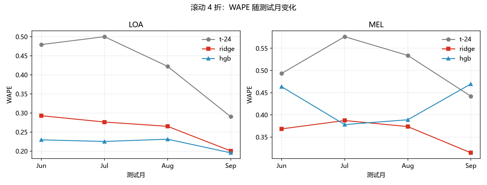
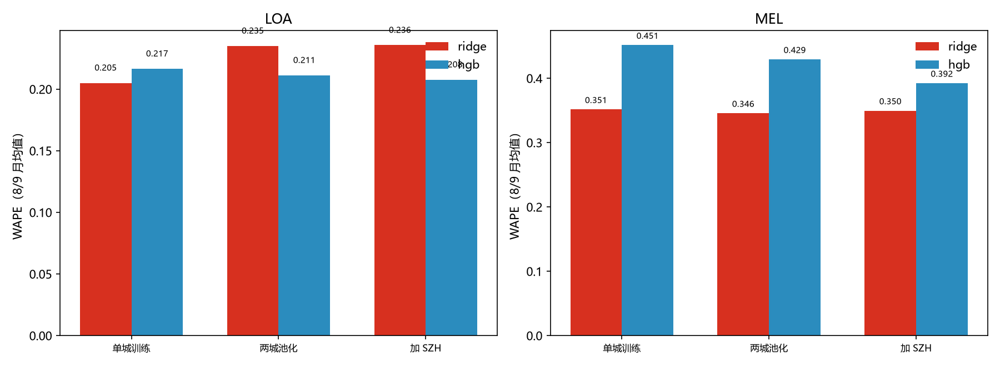
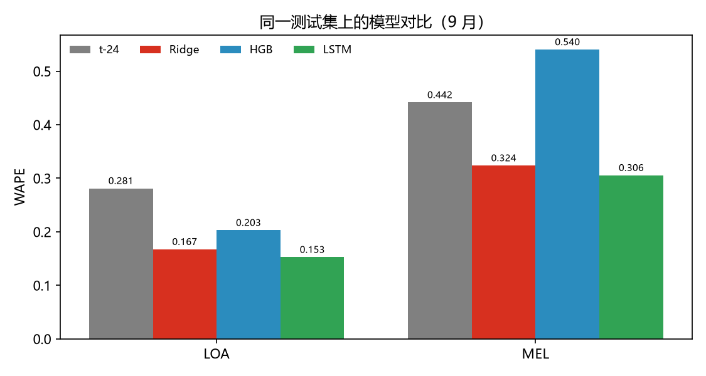
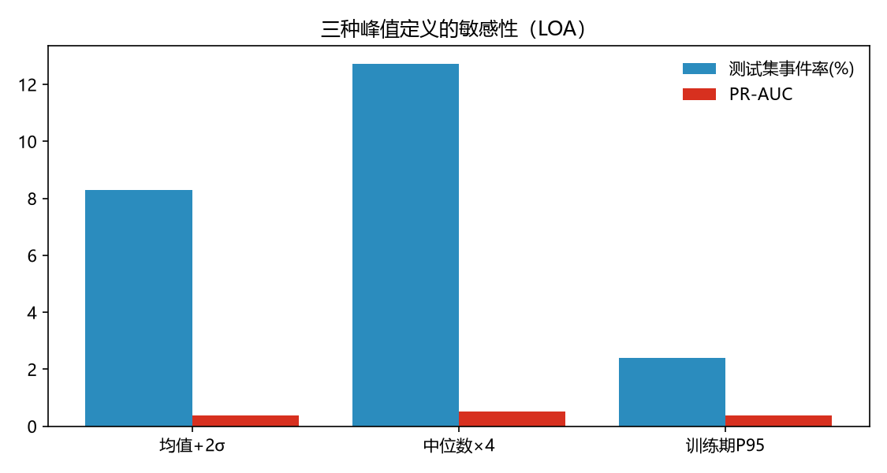
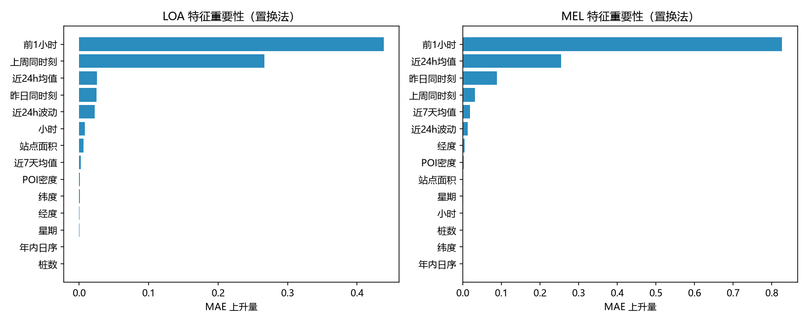
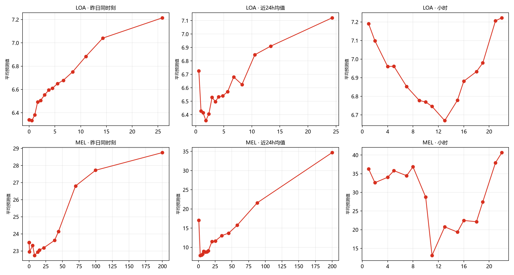
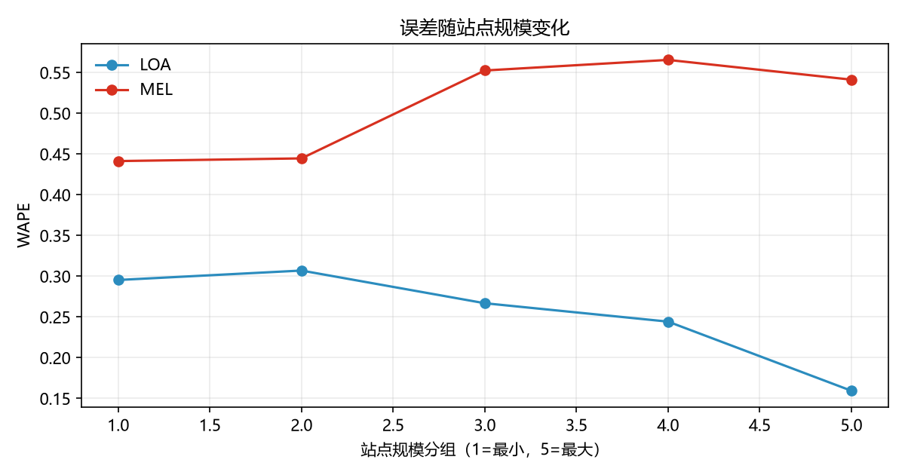
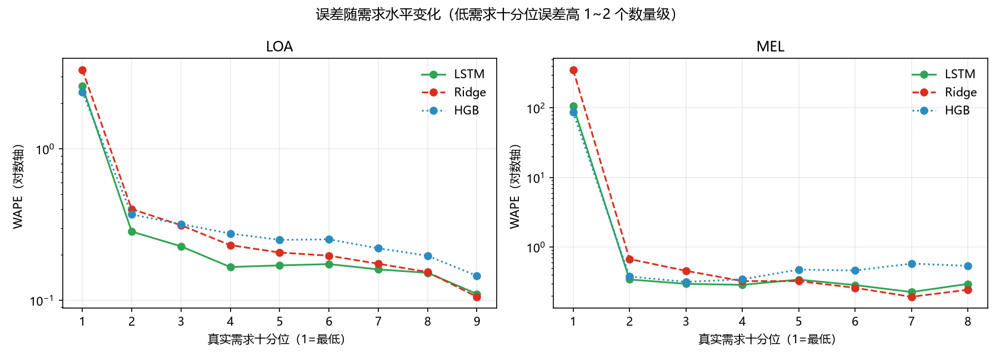
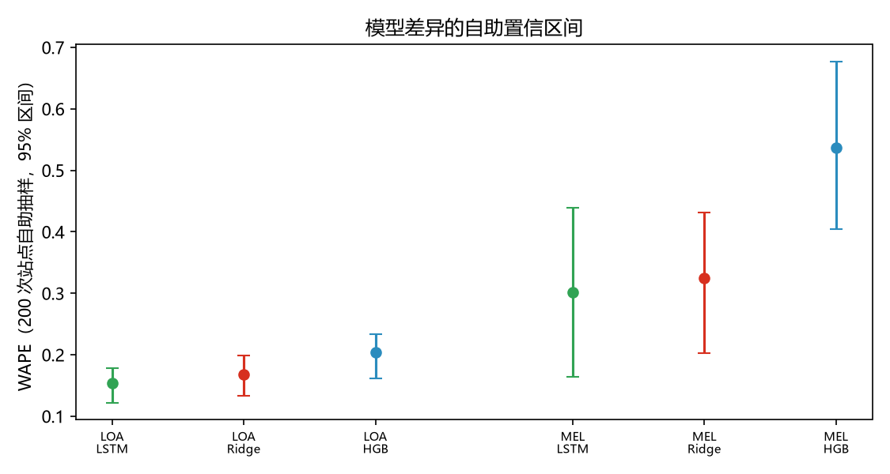
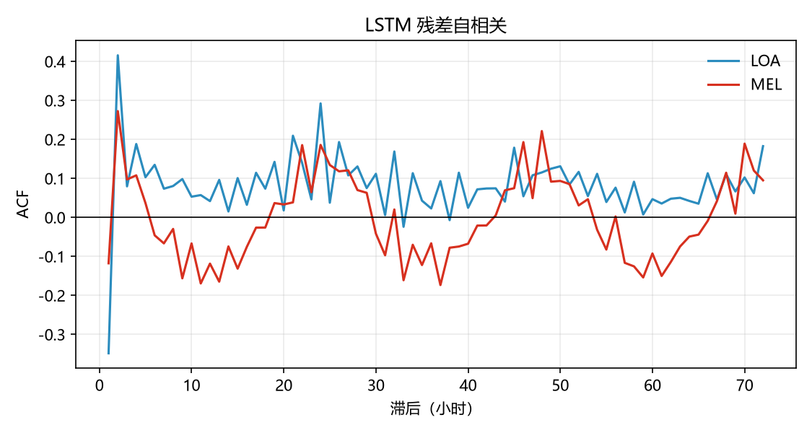

# 结果报告：需求预测与高峰事件识别

## 1. 数据与面板

| 项 | 值 |
|---|---|
| 城市 | LOA（洛杉矶）、MEL（墨尔本） |
| 面板规模 | 128 万站点·小时（LOA 100.6 万 / MEL 27.7 万） |
| 站点 | 286 个（活跃 224 + 62），其中合格站点 255 个（日内 CV≥0.05） |
| 时间 | 2023-04-01 ~ 09-30，逐小时 |
| 特征 | 滞后 t-1/t-24/t-168、滚动 24h/7d 统计、小时/星期/日序、站点静态属性 |
| 标签 | 同小时滚动 28 天均值 + 2σ（因果，shift 1） |

天气特征被剔除：LOA 的充电峰值与太阳辐射峰值相差 13 小时、MEL 相差 0 小时，时间戳口径不一致，无法安全对齐。

## 2. 方法

- **切分**：扩展窗口滚动 4 折（训练 4 月起，依次测试 6/7/8/9 月，段间留 1 天 gap）；
- **回归**：t-24 基线、Ridge、HGB；目标 `log1p(volume)`；
- **分类**：基率、小时×星期频率表、逻辑回归、HGB + isotonic 校准（用测试月前两个月拟合）；
- **指标**：WAPE / MAE / R²（回归），Brier / PR-AUC / F1（分类）。

## 3. 回归：滚动 4 折



| 城市 | 模型 | 6 月 | 7 月 | 8 月 | 9 月 |
|---|---|---|---|---|---|
| LOA | t-24 | .479 | .500 | .422 | .290 |
| LOA | Ridge | .293 | .276 | .265 | .200 |
| LOA | HGB | **.229** | **.225** | **.231** | .195 |
| MEL | t-24 | .493 | .576 | .534 | .442 |
| MEL | Ridge | **.368** | .387 | **.374** | **.314** |
| MEL | HGB | .463 | .378 | .389 | .470 |

**结论**：两个城市都稳定优于 t-24；但 HGB 只在站点多的 LOA 上占优，在只有 62 个站点的 MEL 上不稳定（9 月甚至输给 t-24）。**模型复杂度要与城市规模匹配**。

## 4. 消融：单城 vs 池化 vs 加 SZH



| 变体 | LOA (8/9 月均值) | MEL (8/9 月均值) |
|---|---|---|
| 单城训练 | Ridge .205 / HGB .217 | Ridge .352 / HGB .452 |
| 两城池化 | Ridge .235 / HGB .211 | Ridge .346 / HGB .430 |
| 加 SZH | Ridge .236 / HGB .208 | Ridge .350 / HGB .392 |

**结论**：池化对 LOA 无益（自身数据足够），对 MEL 的 HGB 有显著帮助（.452→.392），但**仍不如单城 Ridge**。SZH 的 634 万行没有带来额外信息——它的一半站点本身就是平坦的。

## 5. 分类：峰值识别

| 折（测试月） | 城市 | 事件率 | Brier | PR-AUC | F1 |
|---|---|---|---|---|---|
| 6 月 | LOA | 4.5% | .035 | .373 | .416 |
| 7 月 | LOA | 4.5% | .037 | .379 | .420 |
| 8 月 | LOA | 2.0% | .020 | .067 | .130 |
| 9 月 | LOA | 8.5% | .064 | .386 | .425 |
| 6 月 | MEL | 7.8% | .049 | .566 | .563 |
| 7 月 | MEL | 4.8% | .040 | .366 | .417 |
| 8 月 | MEL | 5.9% | .050 | .367 | .443 |
| 9 月 | MEL | 4.6% | .048 | .173 | .287 |

**结论**：排序能力存在（PR-AUC 通常是基率的 3~8 倍），但**8 月几乎失效**（LOA PR-AUC .067）。原因是峰值率本身在月份间波动 2%~8.5%，概率校准无法跨月迁移。

## 6. LSTM 对照（GPU）

环境：RTX 3060 Laptop（6 GB），PyTorch 2.14.1 + CUDA 12.6。模型：单层 LSTM（hidden 64），输入过去 24 小时（按站点 z-score），输出下一小时；训练 30 epoch，batch 4096。



同一批测试行（LOA 164,880 行 / MEL 45,360 行）上的对比：

| 城市 | t-24 | Ridge | HGB | **LSTM** |
|---|---|---|---|---|
| LOA | .281 | .167 | .203 | **.153** |
| MEL | .442 | .324 | .540 | **.306** |

**结论修正**：此前“复杂模型没有收益”的判断只对**树模型**成立。LSTM 比 Ridge 再好 8%~9%，在 MEL 上把 HGB 的 .540 直接压到 .306——说明 HGB 在 MEL 上的失败是过拟合，而不是数据没有信号。序列模型 + 按站点归一化，正好补上了小样本城市的短板。

## 7. 峰值定义敏感性（LOA，9 月）



| 定义 | 全期事件率 | 训练期 | 测试期 | Brier | PR-AUC | F1 |
|---|---|---|---|---|---|---|
| 均值 + 2σ | 4.7% | 3.9% | **8.3%** | .064 | .385 | .412 |
| 中位数 × 4 | 8.7% | 7.9% | **12.7%** | .080 | **.517** | **.550** |
| 训练期 P95 | 2.2% | 2.2% | **2.4%** | **.019** | .389 | .400 |

**结论**：滚动阈值“自适应”，但会随需求水平漂移，导致测试月事件率翻倍、概率校准失效；**静态 P95 虽然简单，事件率却最稳定、Brier 最好**。如果目标是“概率可解释”，P95 更合适；如果目标是“抓出异常日”，×4 中位数的召回最高。

## 8. 可解释性



- **前 1 小时**（lag1）是绝对主导特征，其次是上周同时刻 / 近 24h 均值；
- 站点静态属性（POI 密度、面积、经纬度、桩数）贡献几乎为 0。



- 预测值随「昨日同时刻」和「近 24h 均值」单调上升，符合直觉；
- 小时效应呈 U 形：夜间高、午间低——与两城“凌晨/夜间充电为主”的特征一致。



- LOA：站点越大误差越低（.30 → .16），大站更可预测；
- MEL：站点越大误差越高（.44 → .54），大站波动更强、更难预测。

## 9. 结论

1. 所有模型都显著优于朴素基线：LOA 的 WAPE 从 .29~.50 降到 .15~.20，MEL 从 .44~.58 降到 .31~.54。
2. **模型复杂度要看数据规模**：树模型（HGB）并不优于 Ridge，在 MEL 上还因过拟合明显变差；但 LSTM 在两地都最优（LOA .153、MEL .306），说明“序列建模 + 按站点归一化”确实补上了树模型的短板。
3. **预测信号以自回归为主**：滞后特征几乎解释了全部，空间/静态特征贡献很小。
4. **峰值概率的瓶颈是标签漂移**，不是模型：同一模型在 8 月与 9 月的表现相差数倍。
5. **峰值定义会改变结论**：+2σ 会漂移，P95 最稳，×4 召回最高——报告必须写明定义。

## 10. 局限

- 天气特征因时区问题被弃用；
- 只有两个城市，MEL 仅 62 个站点；
- 6 个月覆盖春夏季，无法外推到冬季；
- LSTM 只跑了单折（9 月）、30 epoch 未早停，未做超参搜索；
- 峰值标签本身是构造的，不是真实“事件”。

## 11. 复现

```bash
python scripts/build_panel.py --cities LOA MEL SZH JHB SPO
python scripts/rolling_cv.py
python scripts/ablation.py
python scripts/interpret.py
python scripts/peak_defs.py
python scripts/lstm_model.py      # 需要 CUDA 版 PyTorch
python scripts/compare_lstm.py
```

## 12. 误差分析（补充）

**按需求水平分解**（9 月，同一测试集）：



| 城市 | 最低十分位 WAPE | 其余十分位 WAPE | 最低十分位偏差 |
|---|---|---|---|
| LOA | 2.4 ~ 3.3 | 0.11 ~ 0.40 | 高估 2.3 ~ 3.2 倍 |
| MEL | 87 ~ 354 | 0.22 ~ 0.67 | 高估 86 ~ 354 倍 |

误差几乎全部来自**接近零的小时**：模型在这些时刻把“无充电”预测成了正值。这解释了为什么整体 WAPE 看着不高——它被高需求时段拉低了。

**按站点类型分解**：

| 城市 | 合格站点 WAPE（LSTM） | 平坦站点 WAPE（LSTM） |
|---|---|---|
| LOA | 0.178 | 0.012 |
| MEL | 0.323 | 0.185 |

平坦站点几乎“白送”正确预测，因此**任何跨数据集的指标对比都必须说明站点构成**。

**自助置信区间**（200 次按站点重采样）：



- LOA：LSTM 0.15 [0.13, 0.18] vs Ridge 0.17 [0.14, 0.20]——区间重叠，“LSTM 更好”只能算弱证据；
- MEL：LSTM 0.30 [0.16, 0.44] vs Ridge 0.32 [0.20, 0.43]——几乎完全重叠；HGB 0.53 [0.40, 0.68] 显著更差。

**残差自相关**：



LOA 在滞后 1 有 −0.35、滞后 24 有 +0.29 的峰；MEL 在 24/48 小时处也有峰。说明模型**仍残留日周期结构**，且对上一小时过度修正。

**由此得到的改进方向**：
1. 两段式模型（先判“有无充电”，再预测“有多少”）或 Tweedie 损失，直接针对低需求高估；
2. 增加日周期特征（如 24 小时前的同刻值已在特征里，但模型未用尽），或对残差建模；
3. 所有模型对比都应带自助置信区间，避免把噪声当提升。
